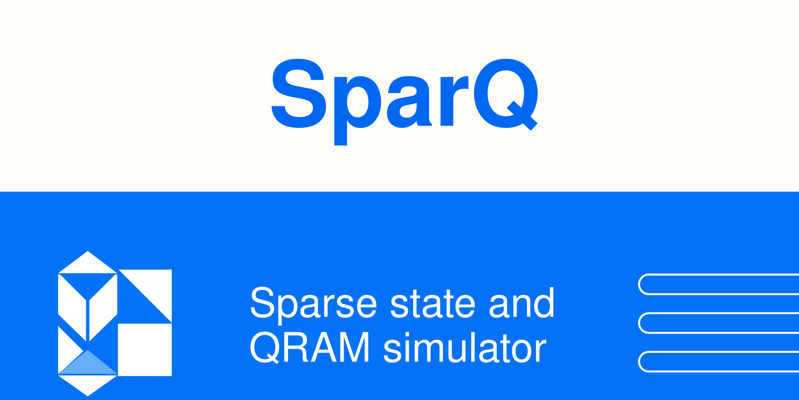

<p align="center">
  
</p>

# SparQSim / pysparq

English | [简体中文](README_zh-cn.md)

[](https://arxiv.org/abs/2503.13832)
[](https://arxiv.org/abs/2503.15118)
[](https://pypi.org/project/pysparq/)
[](https://opensource.org/licenses/Apache-2.0)
[](https://github.com/IAI-USTC-Quantum/SparQSim)
[](https://iai-ustc-quantum.github.io/SparQSim/)

> **pysparq — a full-featured Python framework for sparse-state quantum circuit simulation (Register Level Programming, native QRAM, dynamic operators, RIR interpreter)**

## Highlights

- **Sparse-state quantum simulation with Register Level Programming** — direct register-level arithmetic, native QRAM, dynamic operators, and an RIR interpreter (see the quick start below)
- **Quantum linear-system solving, dual engines** — discrete-adiabatic **QDA** and Chebyshev-quantum-walk **CKS** solvers, validated end to end up to **2^20 dimensions** on a single A800 GPU ([v1d](docs/verification/v1d-qda-linsolver-a800.md), [v1e](docs/verification/v1e-cks-direct-oracle-linsolver.md))
- **CPU (OpenMP) and CUDA backends** with bitwise kernel cross-validation ([v1c](docs/verification/v1c-gpu-cuda-a800.md))

## Repository Responsibilities

Dependency direction: **SparQSim → QRAM-Simulator**. SparQSim releases the
[`pysparq`](https://pypi.org/project/pysparq/) package and hosts the SparQ C++ framework
(`SparQ/` sparse-state simulator + `SparQ_Algorithm/` algorithm library + all Python bindings and algorithm-class experiments);
the QRAM base (Common + QRAM + ThirdParty) is released independently from the
[QRAM-Simulator repository](https://github.com/IAI-USTC-Quantum/QRAM-Simulator)
and is referenced and compiled by this repository as a git submodule (relative URL `../QRAM-Simulator.git`).

| Repository | Contents | PyPI package |
|------------|----------|--------------|
| **SparQSim** (this repository) | SparQ C++ framework + the full-featured pysparq Python framework (rich core.cpp bindings + pure-Python algorithm layer) | `pysparq` |
| [QRAM-Simulator](https://github.com/IAI-USTC-Quantum/QRAM-Simulator) | Pure C++ QRAM base (Common + QRAM circuit core + QRAM paper experiments + thin pybind11 bindings) | `qram-simulator` |

## Installation

```bash
pip install pysparq
```

**Requirements**: Python 3.10 – 3.13, NumPy.

If you need the QRAM circuit-level Python API (the `QRAMCircuitQubit`/`QRAMCircuitQutrit`
noise-simulation workflow), additionally install the standalone package released by the
[QRAM-Simulator](https://github.com/IAI-USTC-Quantum/QRAM-Simulator) repository:

```bash
pip install qram-simulator
```

**GPU support**: the CUDA/GPU backend is disabled by default; enable it at build time by passing `-DSPARQ_ENABLE_CUDA=ON` (requires a local CUDA toolchain; verified with CUDA 13 / CCCL 3 and with CUDA 12.8 / sm_80 on an 8×A800 Linux server — see [`docs/verification/v1c-gpu-cuda-a800.md`](docs/verification/v1c-gpu-cuda-a800.md); the 2^20 CKS/QDA linear-solver production runs on this backend are recorded in [v1e](docs/verification/v1e-cks-direct-oracle-linsolver.md) and [v1d](docs/verification/v1d-qda-linsolver-a800.md)); the PyPI wheel is always CPU-only.

**MPI**: the SparQSim C++ core itself ships no MPI path; trajectory-level MPI ensemble parallelism for the qram-simulator bindings (single-node multi-process, results independent of the process count) is provided by the [QRAM-Simulator repository](https://github.com/IAI-USTC-Quantum/QRAM-Simulator) as `qram_simulator.mpi` — see its "MPI Ensemble Parallelism" section.

### Building from Source

```bash
git clone --recurse-submodules <this-repo-url>
cd SparQSim
pip install .
```

## 5-Minute Quick Start

```python
import pysparq as ps

# 1. Create a sparse state
state = ps.SparseState()

# 2. Define registers (the core of Register Level Programming)
addr_id = ps.AddRegister("addr", ps.UnsignedInteger, 4)(state)
data_id = ps.AddRegister("data", ps.UnsignedInteger, 8)(state)

# 3. Initialize a superposition (all addresses with equal probability)
ps.Hadamard_Int("addr", 4)(state)

# 4. Create a QRAM and load data
memory = [i * 2 for i in range(16)]
qram = ps.QRAMCircuit_qutrit(addr_size=4, data_size=8, memory=memory)

# 5. Perform the QRAM load: |addr⟩|0⟩ → |addr⟩|memory[addr]⟩
ps.QRAMLoad(qram, "addr", "data")(state)

# 6. Do arithmetic directly (no gate compilation needed!)
ps.Add_ConstUInt_InPlace("data", 5)(state)   # data = data + 5

# 7. Measure / query probabilities
ps.set_seed(0)
outcome, prob = ps.MeasureZ("data")(state)
dist = ps.Probability.distribution(state, "addr")
```

## Key Register-Level APIs

```python
# Quantum arithmetic - direct register operations (core of Register Level Programming)
ps.Add_UInt_UInt(in1, in2, out)      # out = in1 + in2
ps.Add_UInt_ConstUInt(reg, const)    # reg = reg + const
ps.Mult_UInt_ConstUInt(in, c, out)   # out = in * c
ps.ShiftLeft(reg, n)                 # shift left by n bits
ps.ShiftRight(reg, n)                # shift right by n bits

# Basic quantum gates
ps.Hadamard_Int(reg, n_digits)       # apply Hadamard to an integer register
ps.X_Bool(reg, pos)                  # X gate (on a specific bit)
ps.Z_Bool(reg, pos)                  # Z gate

# QRAM operations
ps.QRAMLoad(qram, addr_reg, data_reg)      # QRAM load
ps.QRAMLoadFast(qram, addr_reg, data_reg)  # fast version

# Seedable measurement / reset / probability queries (for dynamic executors: mid-circuit MEASURE/RESET/QIF)
ps.set_seed(seed)                          # seed the global random engine, making sampling results reproducible
outcome, prob = ps.MeasureZ(reg)(state)    # projective Z-basis measurement: collapse + renormalization
measured = ps.Reset(reg, target=0)(state)  # measure + classically conditioned flips, forcing a reset to target
p = ps.Probability(reg, value)(state)      # read-only Born probability query, leaves the state unchanged
dist = ps.Probability.distribution(state, reg)  # full outcome distribution of a single register (read-only)
```

## High-Level Algorithm Library (`pysparq.algorithms`)

An algorithm layer implemented in pure Python that composes public primitives (Grover, Shor, QDA, CKS, state preparation, block encoding, etc.);
its one-to-one correspondence with the C++ experiment code is documented in [docs/algorithm-implementation.md](docs/algorithm-implementation.md).

## Quantum Linear-System Benches (CKS / QDA, validated at 2^20)

The C++ layer ships production Poiseuille tridiagonal linear-system benchmarks
(`A = tridiag(-1, α, -1)`, `b = ones(n)/sqrt(n)`, κ = 16) with an identical CLI and
artifact schema for both engines (`residual_curve.csv` + `qda_summary_cpp.json`):

```bash
# QDA (discrete adiabatic) — at 2^20 the default --czEps prunes the solution
# branch; size it by dimension/schedule as described below
./Experiment_PoiseuilleQDABench_cuda --nqubit 20 --kappa 16 --steprate 1.1 \
    --tol 1e-6 --logEvery 250 --czEps 1e-20 --outdir qda_2p20

# CKS (Chebyshev quantum walk, QRAM-free direct oracles)
./Experiment_CKS_PoiseuilleBench_cuda --nqubit 20 --kappa 16 --eps 0.01 \
    --ds 32 --coef true --J 1024 --logEvery 64 --tol 1e-6 --outdir cks_2p20
```

Verified results (single A800, CUDA sparse-state backend):

- **CKS at 2^20** (QRAM-free direct oracles, built with `-DCACHED_REGISTER_SIZE=16`):
  direction residual `0 ≤ 1e-6` with early termination at 640/1024 Chebyshev terms,
  fidelity `1.0000000000`, success probability `4.75e-2`, 20,971,512 walk states,
  2682 s wall time; dim16/dim64 success probabilities bitwise-identical to the CPU
  reference — [v1e](docs/verification/v1e-cks-direct-oracle-linsolver.md).
- **QDA at dim256**: the full 40568-step schedule converges to `res_dir = 5.9485e-4`
  (fidelity `1.000000`, success probability `1.0`); the 2^20 production re-run is in
  progress and the record is continuously updated —
  [v1d](docs/verification/v1d-qda-linsolver-a800.md).

### Sizing `--czEps` by dimension and schedule (QDA)

`ClearZero` prunes basis states with |amplitude|² < eps. The QDA solution branch is
born with per-state amplitudes ≈ sqrt(2e-6/n), shrinking linearly as the schedule is
refined (ds = 1/steps), so the rule of thumb is
**keep sqrt(czEps) below the solution-branch birth amplitude**:

| Schedule | Working `--czEps` |
|----------|-------------------|
| coarse (`--steprate 0.1`) | `1e-16` |
| fine (`--steprate 1.1`, production) | `1e-20` – `1e-22` |

At the library default `1e-14` (amplitude cutoff 1e-7) the solution branch is pruned
at birth from dim 2^19 upward — measured cliff: 2^17 (2.9e-7) and 2^18 (1.5e-7)
survive, 2^19 (7.4e-8) and 2^20 (3.7e-8) are pruned, which surfaced as all-NaN
extraction in the first 2^20 run. Commit `10a96aa` made the threshold
dimension-adaptive via `--czEps` (default behavior bitwise-unchanged); the full
analysis lives in the [v1d addendum](docs/verification/v1d-qda-linsolver-a800.md).

## Documentation

The full documentation site is hosted on GitHub Pages: https://iai-ustc-quantum.github.io/SparQSim/

- [Quick Start](https://iai-ustc-quantum.github.io/SparQSim/en/guide/quickstart.html) and [Core Concepts](https://iai-ustc-quantum.github.io/SparQSim/en/guide/core_concepts/index.html)
- [Operator Reference](https://iai-ustc-quantum.github.io/SparQSim/en/operators/index.html) — the full register-level operator catalogue
- [Algorithm Guide](https://iai-ustc-quantum.github.io/SparQSim/en/guide/algorithms/index.html) — Grover / Shor / QDA / CKS / block encoding
- [Interactive Tutorials](https://iai-ustc-quantum.github.io/SparQSim/en/notebooks/01_quickstart.html) — runnable notebooks
- 中文版站点：[中文文档](https://iai-ustc-quantum.github.io/SparQSim/zh/index.html)

## Project Structure

```
SparQSim/
├── SparQ/                  # SparQ C++ sparse-state simulator (umbrella target SparQ defined in the root CMake)
├── SparQ_Algorithm/        # High-level algorithm C++ library (state preparation, block encoding, Hamiltonian simulation, QDA, etc.)
├── Experiments/            # Quantum algorithm C++ experiments (QDA/Grover/QFT/Shor/QCNN/CKS/GHZ, etc.)
├── test/                   # C++ tests (SparQ unit tests + full CommonTest; gated by SPARQ_BUILD_TESTS)
├── extern/qram-simulator/  # QRAM base submodule (Common + QRAM + ThirdParty; relative URL ../QRAM-Simulator.git)
├── PySparQ/
│   ├── core.cpp            # pybind11 rich bindings (_core module)
│   ├── pysparq/            # Python package (operators/ algorithms/ rir conformance dynamic_operator)
│   └── test/               # pytest suite
├── docs/                   # Sphinx documentation + algorithm porting guide
├── examples/               # C++ and Python examples (C++ part gated by SPARQ_BUILD_EXAMPLES)
└── pyproject.toml          # pysparq package (scikit-build-core + setuptools-scm)
```

## Release Process

1. Merge changes into main on Gitea (the primary development repository);
2. When a new core version is needed, first wait for [QRAM-Simulator](https://github.com/IAI-USTC-Quantum/QRAM-Simulator)
   to release the corresponding tag, then run `git submodule update --remote` (or check out that tag) and commit the pin;
3. Sync to the GitHub upstream `IAI-USTC-Quantum/SparQSim`;
4. Update `CHANGELOG.md` and tag `vX.Y.Z` (continuing the pysparq version series; next release v0.2.0);
5. Push the tag or create a GitHub Release → the `pypi-publish` workflow automatically builds
   cp310–313 × (manylinux / win_amd64) wheels + sdist (the sdist embeds the core source and is self-contained)
   and publishes them to PyPI (Trusted Publishing / OIDC).

The frozen API dependencies of external consumers (qecc_lang, quantum_cfd QFVM) are listed in
`PySparQ/consumer_runtime_inventory.json` and enforced by `PySparQ/test/test_consumer_runtime_contract.py`.

## Papers and Citation

See the [QRAM-Simulator repository README](https://github.com/IAI-USTC-Quantum/QRAM-Simulator#papers-and-citation).

## About Us

This project is developed by **[IAI-USTC Quantum](https://github.com/IAI-USTC-Quantum)** (the Quantum Artificial Intelligence Team at the Institute of Artificial Intelligence, Hefei Comprehensive National Science Center).

## License

Apache-2.0 License
